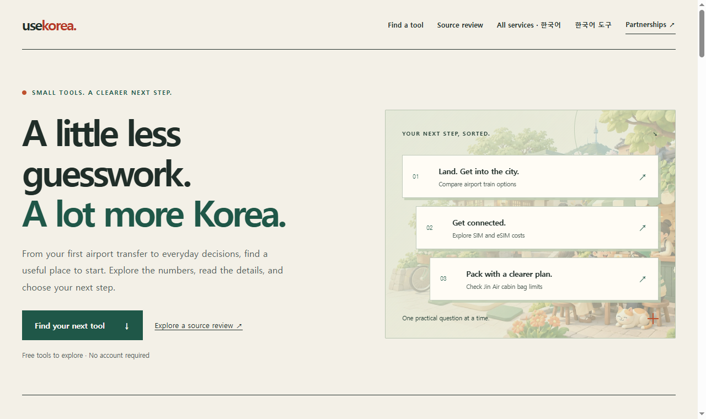

# Hyungjo Kim

I build practical tools that turn speech and paperwork into structured, searchable documents.
Most of them run fully offline on Windows, because the recordings and legal documents they handle are confidential.

음성과 서류를 구조화된 문서로 바꾸는 실무용 도구를 직접 만들어 매일 쓰고 있습니다.

**Focus**
- Speech to text: speaker-diarized transcripts, audio preprocessing for LLM transcription
- Document automation: HWP/HWPX/PDF conversion, OCR, proofreading, splitting
- Windows utilities and small web products

**Stack:** Python · C# / .NET (WPF) · C++ · JavaScript (React) · PowerShell · FastAPI · faster-whisper · pyannote.audio · PaddleOCR · PyMuPDF · FFmpeg

## Featured

| Project | What it does | Built with |
|---|---|---|
| [voice2txt](https://github.com/igozigu/voice2txt) | Drop in an audio file, get a timestamped transcript split by speaker. Audio never leaves the PC. | Python, faster-whisper, pyannote.audio, customtkinter |
| [youtube-subscript](https://github.com/igozigu/youtube-subscript) | Batch-extracts transcripts from YouTube channels and playlists; exports TXT, ZIP, Markdown and JSON. | Python, yt-dlp, FastAPI, React, Docker |
| [hwp_popup](https://github.com/igozigu/hwp_popup) | Single-exe guard for Hancom Office COM automation: security module, registry entries, approval popups. | C# / .NET |

## More tools I use every day (private repositories)

| Project | What it does | Built with |
|---|---|---|
| voice_coding | Down-encodes long recordings for LLM transcription, with SHA-256 integrity logging | Python, FFmpeg |
| pdf_ocr | Korean/English searchable-PDF OCR | Python, PaddleOCR, PyMuPDF |
| quote_fix | Detects and fixes quotation-mark direction in HWPX documents | Python |
| hwp2pdf, auto_pdf | HWP/HWPX to PDF converters (batch folder mode, Explorer context menu) | C# |
| hwp2hwpx | HWP to HWPX converter with a drag-and-drop GUI | Python |
| pdf_chopper | Splits PDFs by their bookmarks (table of contents) | Python |
| break_excel | Splits every sheet of a workbook into its own .xlsx file | Python |
| folder-chopper, break_folder | Auto-extracts archives and flattens folder trees | Python |
| find_folder | Folder-name search launcher for Windows | C#, WPF, .NET 10 |
| copy_path | Tray utility that copies selected file paths with Ctrl+Shift+C | C# |
| clip2txt, clip2img | One-click clipboard to TXT / JPG savers | PowerShell |
| play_trade | Offline trainer for stock-trading (HTS) order routines | C# |

## Live

- [usekorea.com](https://usekorea.com): practical tools for your next step in Korea
- [kpop.usekorea.com](https://kpop.usekorea.com): K-pop schedules for international fans

## Next

Exploring hands-free capture on AI glasses: conversation in, speaker-separated transcript and structured document out.
